# Personal Finance Tracker – Frontend

## 1. Introduction of the Project

The Personal Finance Tracker is a responsive web application developed using React.js to help users manage their personal finances.

The frontend provides an interactive interface through which authenticated users can record income and expenses, view financial summaries, analyze spending patterns through charts, and manage monthly budgets.

The application is designed to provide a simple and user-friendly experience across desktop and mobile devices.

### Objectives

- Provide an intuitive financial management interface.
- Allow users to record and manage income and expenses.
- Display financial summaries and charts.
- Provide transaction search, filtering and sorting.
- Support monthly budget management.
- Offer a responsive user experience.

## 2. Technology Stack and Reasons

| Technology | Purpose | Reason for Selection |
|---|---|---|
| React.js 19 | Frontend development | Component-based architecture and reusable UI |
| Vite 8 | Development environment | Fast development server and optimized builds |
| Tailwind CSS 4 | Styling | Responsive design and utility-based styling |
| Recharts 3 | Data visualization | Interactive pie and bar charts |
| ESLint 10 | Code quality | Identifying coding issues and maintaining consistency |
| JavaScript | Programming language | Application logic and component development |

### Why These Technologies?

**React.js:** Used to create reusable components and manage dynamic user interfaces.

**Vite:** Provides a fast development environment and production build process.

**Tailwind CSS:** Makes it easier to create consistent and responsive layouts.

**Recharts:** Used to visualize financial information through charts.

**ESLint:** Helps maintain code quality and identify potential errors.

## 3. Frontend Features and Use Cases

### 3.1 User Registration and Login

Users can register using their name, email address and password. Existing users can log in to access their personal dashboard.

### 3.2 Dashboard

The dashboard displays:
- Total balance
- Total income
- Total expenses
- Income versus expenses bar chart
- Category-wise expense pie chart

### 3.3 Transaction Management

Users can:
- Add income and expense transactions.
- Edit existing transactions.
- Delete transactions.
- View transaction history.
- Search transactions.
- Filter by category, type and date range.
- Sort transactions by date.

### 3.4 Budget Management

The Budget page allows users to:
- Create monthly budgets.
- Select expense categories.
- Set budget amounts.
- View actual spending.
- View remaining budget.
- Monitor spending progress.
- Edit and delete budgets.
- View expense categories even when a budget has not yet been created.

### 3.5 Responsive Design

The frontend is designed to adapt to desktop and mobile screen sizes. Dashboard cards, charts, navigation and budget information adjust to smaller displays.

## 4. Research and Analysis

The frontend design was planned around the requirements in the project brief and the identified use cases.

The following design considerations guided the implementation:

| Requirement | Frontend Solution |
|---|---|
| Easy financial overview | Dashboard summary cards |
| Understanding spending patterns | Pie and bar charts |
| Managing financial records | Transaction management interface |
| Finding specific records | Search and filtering controls |
| Monitoring monthly expenses | Budget overview and progress indicators |
| Accessibility across devices | Responsive Tailwind CSS layouts |
| Reusable user interface | React components |

The design focuses on making financial information easy to access, understand and manage.

## 5. Project Explanation with Screenshots

### 5.1 Login Page

The login page allows existing users to authenticate and access their personal financial information.

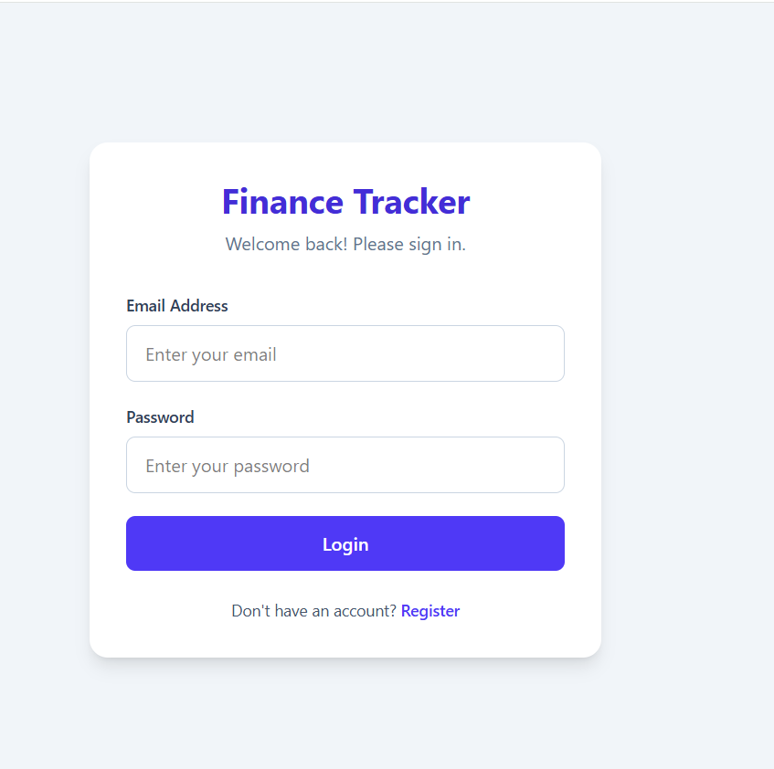

### 5.2 Registration Page

New users can create an account by entering their name, email address and password.

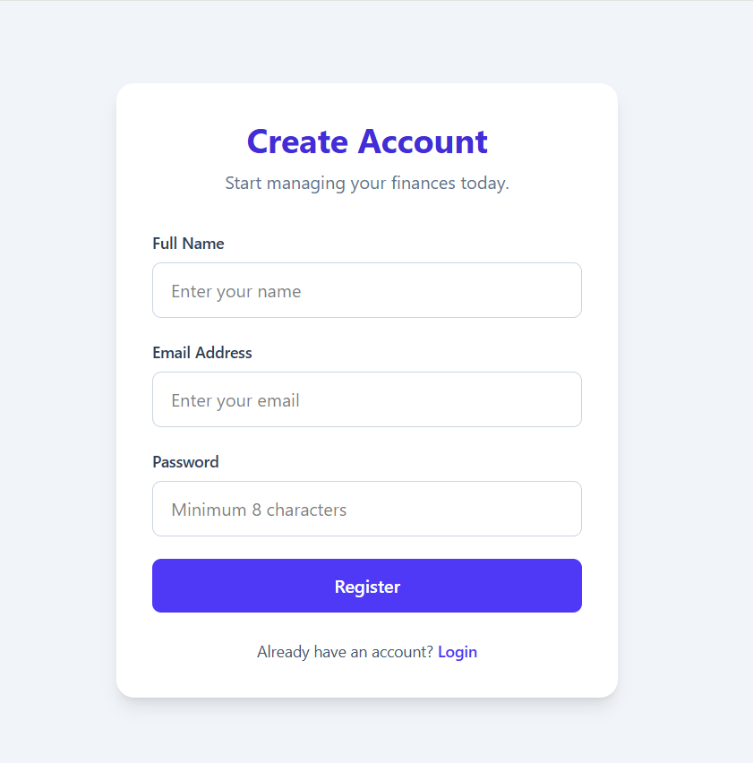

### 5.3 Dashboard Overview

The dashboard provides a summary of the user's financial position, including income, expenses and balance.

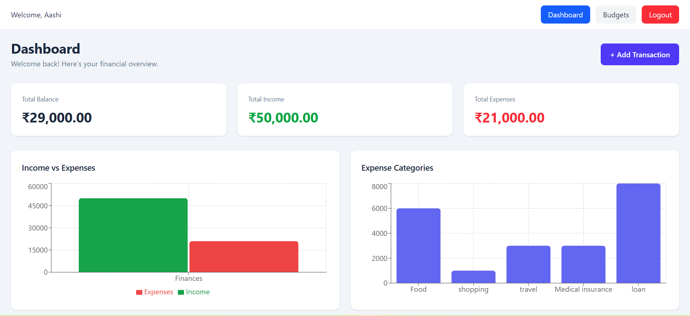

### 5.4 Transaction History

Users can view transaction records and use search, category filters, type filters, date ranges and sorting options.

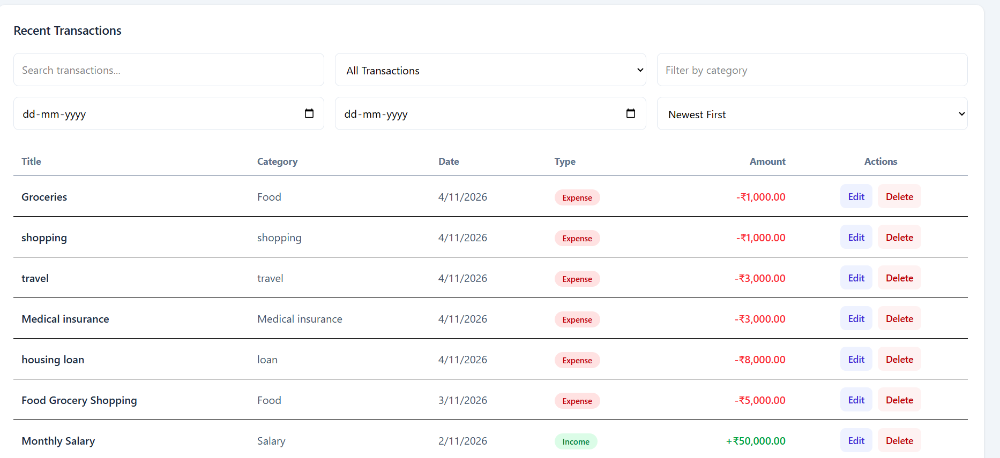

### 5.5 Add Transaction

The Add Transaction form allows users to enter the transaction type, title, amount, category, date and description.

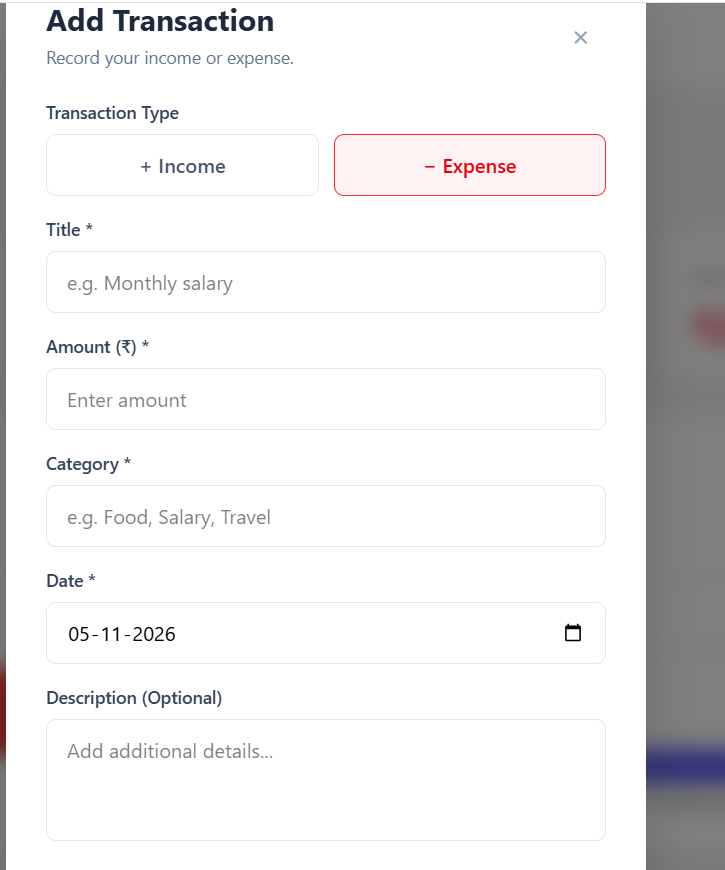

### 5.6 Edit Transaction

Users can update the details of previously recorded transactions.

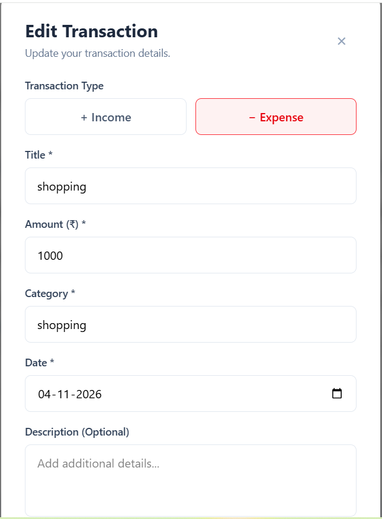

### 5.7 Monthly Budget Overview

The budget overview displays category-wise spending, planned budget amounts, remaining balances and spending progress.

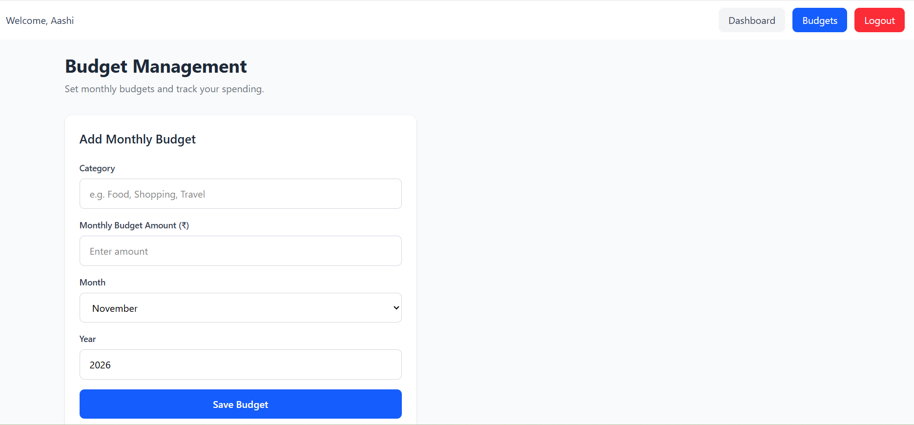

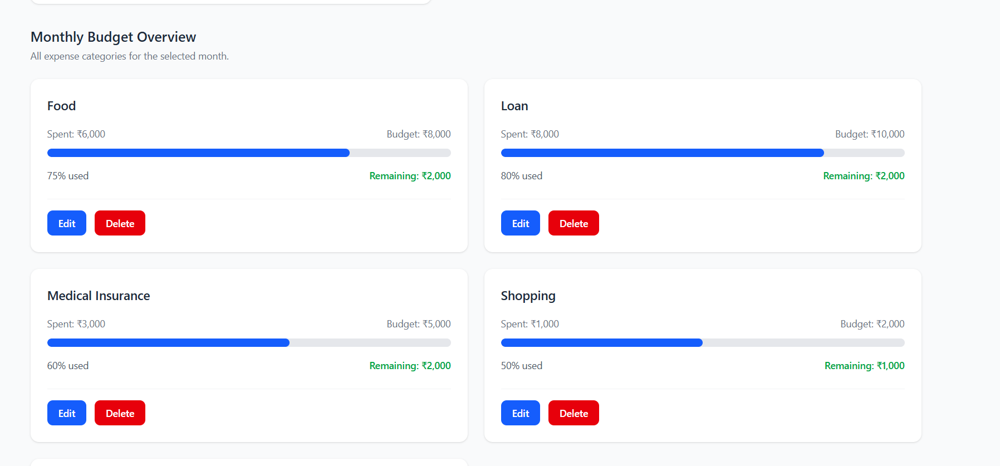

### 5.8 Edit Budget

Users can update the budget amount for an existing category.

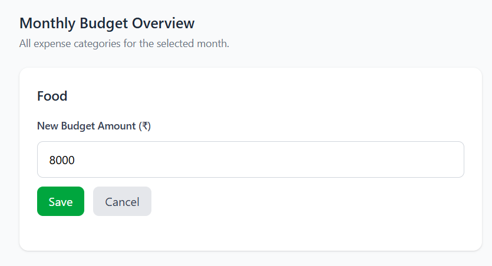

### 5.9 Mobile Responsive Dashboard

The dashboard adapts to mobile screens, displaying financial summary cards in a mobile-friendly layout.

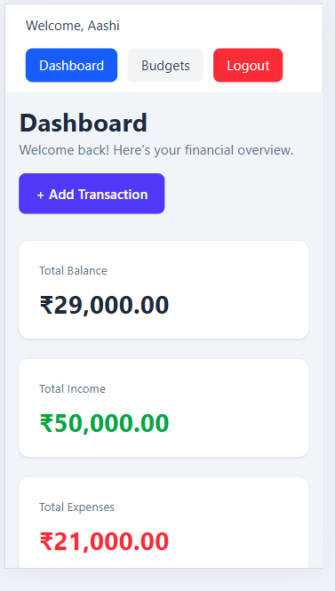

The financial charts are also adjusted to fit the mobile display.

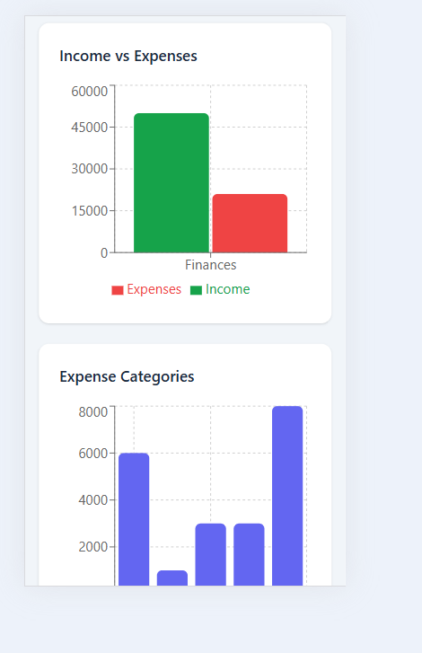

The transaction section provides access to transaction records and filtering controls on mobile devices.

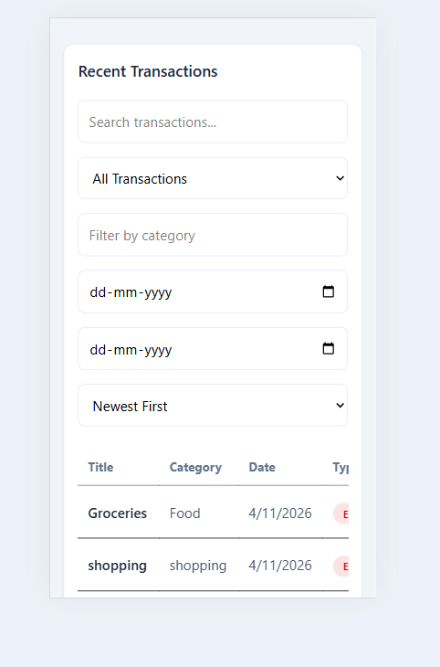

### 5.10 Mobile Responsive Budget Page

The Budget page adapts to smaller screens while maintaining access to budget information and spending progress.

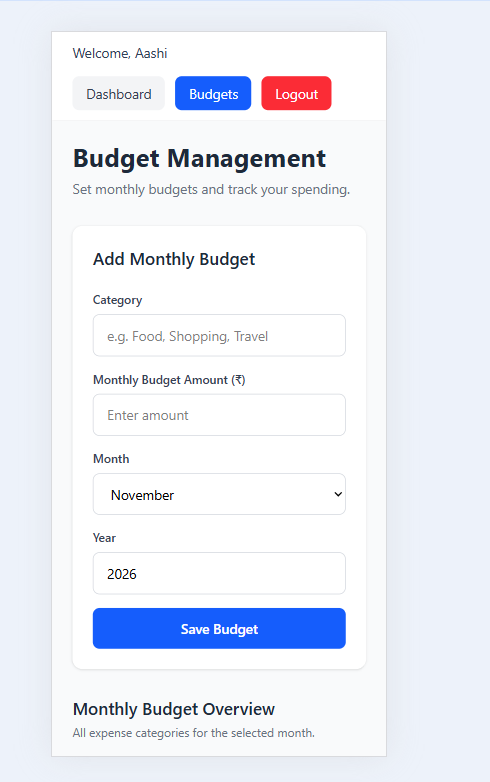

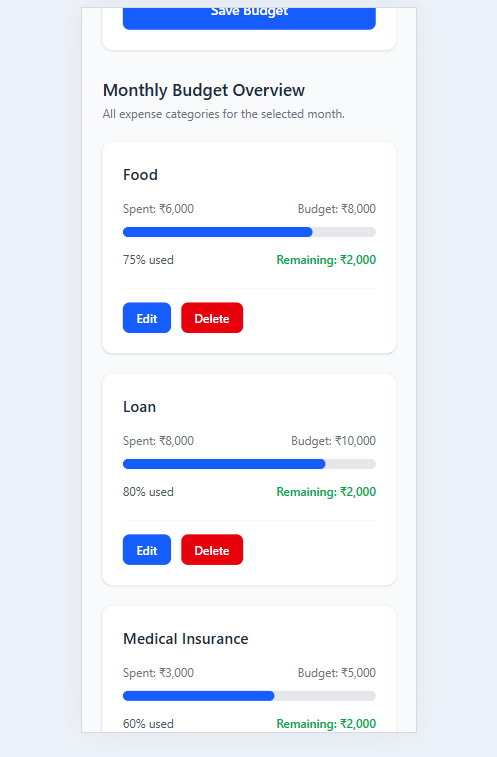

## 6. Conclusion

The Personal Finance Tracker frontend provides an interactive and responsive interface for managing personal finances.

Using React.js, Tailwind CSS and Recharts, the application presents financial information through reusable components, summary cards, charts and budget management screens.

The project demonstrates practical frontend development skills, including component-based architecture, API integration, dynamic rendering, form handling, responsive design and data visualization.

## 7. Installation and Setup

### Prerequisites

- Node.js
- npm
- Git

### Step 1: Clone the Frontend Repository

```bash
git clone https://github.com/suma-venu/personal-finance-tracker-frontend.git
```

### Step 2: Navigate to the Client Folder

```bash
cd personal-finance-tracker-frontend
```

If the repository itself contains the frontend files directly, run the commands from its root directory.

### Step 3: Install Dependencies

```bash
npm install
```

### Step 4: Start the Development Server

```bash
npm run dev
```

Open the local URL displayed by Vite, normally:

```text
http://localhost:5173
```

### Additional Commands

Build the production application:

```bash
npm run build
```

Run ESLint:

```bash
npm run lint
```

Preview the production build:

```bash
npm run preview
```

### Backend Connection

The frontend communicates with the Node.js and Express backend through REST API endpoints.

The backend must be running for authentication, transaction management and budget operations to work.

**Backend Repository:**  
https://github.com/suma-venu/personal-finance-tracker-backend

---

**Project:** Personal Finance Tracker  
**Frontend:** React.js, Vite, Tailwind CSS and Recharts  
**Backend:** Node.js and Express.js  
**Database:** MongoDB Atlas
